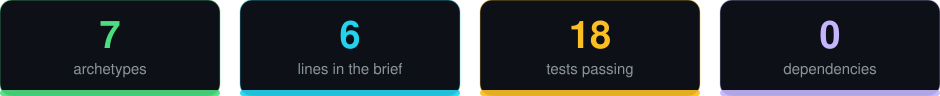
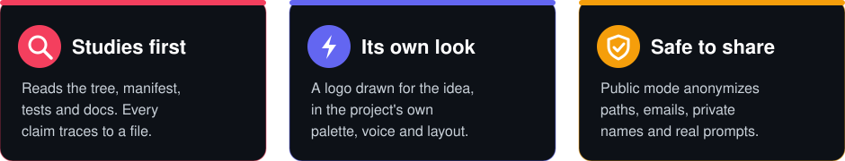
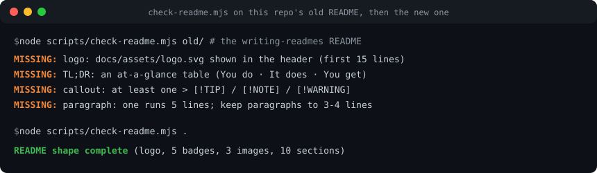

<div align="center">


# readmelyzer

**Every project deserves its own front door.**
An agent skill that studies your repo, then designs a README for it: its own logo, colors, voice and examples.

<a href="#quick-start"></a>
<a href="#quick-start"></a>
<a href="#quick-start"></a>
<a href="#quick-start"></a>
<a href="#quick-start"></a>
<a href="LICENSE"></a>

<br>



<br>



</div>

**Before:** you ask an agent for a README and get the same page every time: folder names as headings, no picture, no example, maybe your home path in the install step.
**After:** you get one that looks and sounds like *this* project, with a checker that proves it is complete and safe to share.

<p align="center">
  
</p>

## Quick start

```bash
# 1. get the skill (Claude Code)
git clone https://github.com/EranTzarum/readmelyzer.git ~/.claude/skills/readmelyzer

# 2. verify
cd ~/.claude/skills/readmelyzer && node --test scripts/check-readme.test.mjs scripts/make-visuals.test.mjs   # expected: pass 18, fail 0

# 3. use it: in any repo, ask your agent
#    "write a README for this project"  (or just: readmelyzer)
```

> [!TIP]
> Planning to share the repo? Create `~/.readmelyzer/private-terms.txt` with your client names, internal codenames and usernames, one per line. `--public` will flag any of them it finds.

<details>
<summary><b>Codex CLI and Cursor</b></summary>

Copy the same folder into each tool's skill root. The folder name must stay `readmelyzer`.

| Tool | Skill root |
|---|---|
| Claude Code | `~/.claude/skills/readmelyzer` |
| Codex CLI | `~/.codex/skills/readmelyzer` |
| Cursor | `~/.cursor/skills/readmelyzer` |

</details>

## Try it

Say you have a small Python CLI that renames photos by the date they were taken. You ask for a README, and readmelyzer opens with its brief (the demo above):

```text
Archetype:   CLI
Audience:    people with messy photo folders; comfortable with a terminal, not with Python
Personality: friendly + tidy
Metaphor:    a camera whose photos fall into labelled date folders
Palette:     ink #1F2937, accent #10B981 (fresh green), soft #D1FAE5
Visibility:  public
```

From that brief:

- the **logo** is a small camera with three stacked folders;
- the **layout** leads with a one-line install and a terminal image of a real run;
- the **example** renames `IMG_0412.jpg` to `2024-06-01_0412.jpg` in `~/Pictures/trip/`, not in your real folder;
- the **voice** says *"Point it at a folder. Every photo lands where you'd look for it."*

A README for a security library would get a shield, a rigorous voice and an API section. Same skill, a different front door.

The checker has its own output, and it runs on any repo:

<p align="center">
  
</p>

```bash
node ~/.claude/skills/readmelyzer/scripts/check-readme.mjs <repo> [--public] [--all-files]
```

## More

| Read | For |
|---|---|
| [docs/how-it-works.md](docs/how-it-works.md) | Why it exists, what it does, the pipeline, every file |
| [docs/verify-and-extend.md](docs/verify-and-extend.md) | What the tests prove, and how to add an archetype, a primitive or a privacy rule |
| [docs/faq.md](docs/faq.md) | Overwriting, existing logos, git history, private terms, API keys |
| [docs/research-readme-patterns.md](docs/research-readme-patterns.md) | The study of top READMEs behind the engagement budget |
| [references/visual-kit.md](references/visual-kit.md) | The animated demo, stat tiles and cards, and the `visuals.json` spec behind them |

## License

[MIT](LICENSE) © 2026 Eran Tzarum

<div align="center"><sub>Made for repos that deserve a second look.</sub></div>
