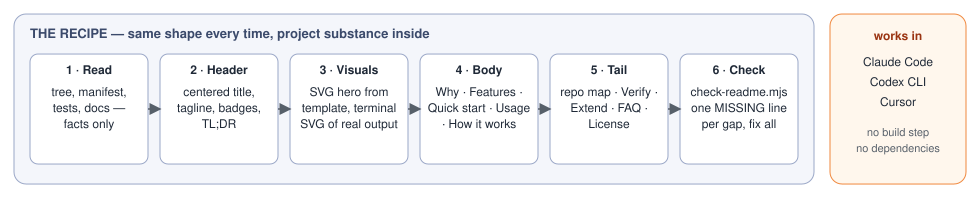
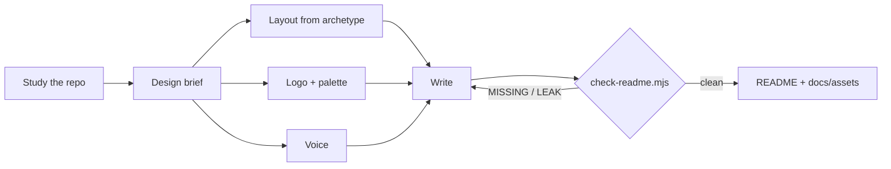

# How readmelyzer works

## Why

Ask an agent for a README and you get the same page every time: the folder names as headings, no picture, no example, and maybe your home path in the install step.

Fixing the *structure* isn't enough either. A fixed template makes a CLI, a mobile app and a research repo all look alike, and a monogram in a gradient square is still generic.

readmelyzer starts from the project instead. It works out who the README is for, what the project feels like, and what single image captures it. Everything else follows from that.

## What it does

- 🔎 **Studies before writing.** Reads the tree, manifest, tests, docs and any existing brand colors. Every claim traces to a file.
- 🧭 **A design brief per project.** Archetype, audience, personality, metaphor, palette, visibility: six lines, shown to you, then used for every choice.
- 🧱 **Layouts that fit.** Seven archetypes (agent skill, CLI, library, app, template, workspace, research) each get their own sections and order.
- 🎨 **A logo drawn for the idea.** A flat pictogram of the project's metaphor in its own palette, reused across the hero and diagrams. Never a letter in a square.
- 🗣️ **A voice that matches.** Calm and precise, playful and fast, rigorous and safe: the brief picks one, and the writing follows.
- 🕶️ **Public mode.** Personal paths, emails, private project names and real prompts are anonymized. Your own list of private terms stays in your home folder, never in a repo.
- ✅ **A checker that knows when it's done.** `scripts/check-readme.mjs` reports `MISSING:` parts and `LEAK:` details until the README is complete and clean.

## The pipeline

  

1. **One brief, every decision.** Layout, logo, colors and wording all trace back to the same six lines, so the page feels designed rather than assembled.
2. **The checker owns the mechanics.** Structure and privacy are scripted; the agent spends its judgment on taste.
3. **Private by default.** Unless the brief says private, examples keep the real problem shape but use invented details.

## Every file

| Part | What it holds |
|---|---|
| `SKILL.md` | the workflow: study → brief → layout → design → write → check |
| `references/archetypes.md` | sections, order, hero and example style for 7 kinds of project |
| `references/logo-guide.md` | how to turn a metaphor into a pictogram, with a primitive cookbook |
| `references/privacy.md` | what to remove, how to anonymize an example, the private-terms file |
| `references/template.md` | section modules to pick from |
| `assets/*.svg.tmpl` | logo frame, pipeline hero and terminal templates, with palette tokens |
| `scripts/check-readme.mjs` | the structure + privacy checker |

Back to the [README](../README.md).
