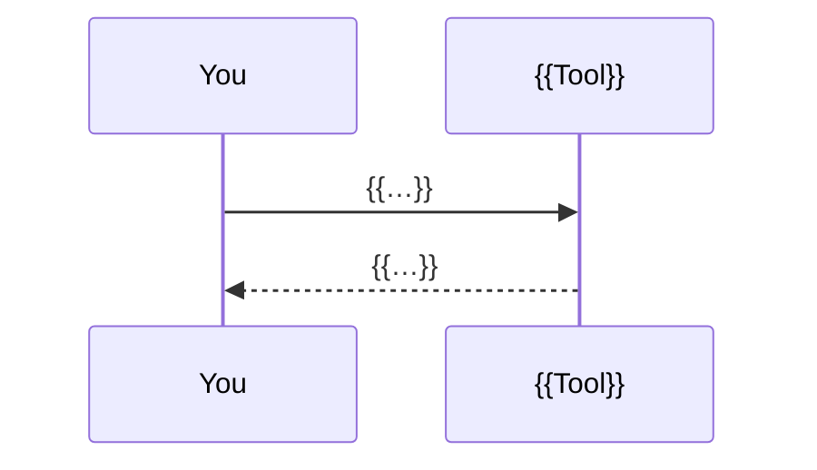

<!-- BUDGET (checked): pitch ≤ 40 lines before the first "## ", demo in the first 40 lines, at most one table
     before the first example, example by line 100, whole README ≤ 160 lines. Modules from "How it works" down are
     REFERENCE: put each in docs/<topic>.md with one link, or fold it in <details>. -->
<!-- Module library, not a fixed order. references/archetypes.md picks the modules and their order for this
     project; drop any module with nothing true to say. {{ACCENT_HEX}} = the brief's accent without '#'. -->
<div align="center">


# {{NAME}}

**{{HOOK — the benefit in one bold line, e.g. "Long prompts in, finished work out."}}**
{{ONE PLAIN LINE — what the reader gets, in words a newcomer knows.}}

<a href="#-quick-start"></a>
<a href="#-quick-start"></a>
<a href="LICENSE"></a>
<!-- 4-6 for-the-badge badges: one per tool/runtime it works with (logo = a simple-icons slug, color = the tool's brand color), then tests and license. -->

<br>


<br>


</div>

**Before:** {{what the reader did by hand — one or two lines.}}
**After:** {{what they do now — one line, the command.}}

<p align="center">
  
</p>
<!-- demo.svg, stats.svg and cards.svg come from docs/assets/visuals.json via scripts/make-visuals.mjs (references/visual-kit.md). -->

---

## 🚀 Quick start

```bash
# 1. install
{{install command}}

# 2. verify
{{verify command}}   # {{expected output}}

# 3. first run
{{first command}}
```

> [!TIP]
> {{The shortcut or gotcha people miss on day one.}}

<details>
<summary><b>{{Other platforms / harnesses}}</b></summary>

| {{Platform}} | {{Path or command}} |
|---|---|
| {{…}} | {{…}} |

</details>

---

## 🧭 Usage

| Command | What happens |
|---|---|
| `{{cmd}}` | {{…}} |

<p align="center">
  
</p>

```bash
{{the exact command that produced it}}
```

---

## ⚙️ How it works



1. **{{Idea.}}** {{why it matters}}.
2. **{{Idea.}}** {{…}}.

| Part | Takes | Produces |
|---|---|---|
| `{{file}}` | {{…}} | {{…}} |

---

## 📦 What lands in your project

```
{{path}}              {{what it is, in a few words}}
```

---

## 🗂 Repository map

<details>
<summary><b>Show the tree</b></summary>

```
{{file}}              {{purpose}}
```

</details>

---

## 🧪 Verify

```bash
{{test command}}
```

{{One or two sentences: what passing proves.}}

---

## 🧩 Extend

- **{{Add X}}** — {{file to touch}}.
- **{{Add Y}}** — {{…}}.
- **{{Add Z}}** — {{…}}.

---

## ❓ FAQ

<details><summary><b>Does it overwrite my files?</b></summary>

{{one-line answer}}
</details>

<details><summary><b>Does it touch secrets, commit or deploy?</b></summary>

{{…}}
</details>

<details><summary><b>What if I already have {{…}}?</b></summary>

{{…}}
</details>

<details><summary><b>{{Platform question}}?</b></summary>

{{…}}
</details>

---

## 📄 License

[MIT](LICENSE) © {{year}} {{owner}}

<div align="center"><sub>{{one warm closing line, e.g. "Made for agents that should finish what they start."}}</sub></div>
